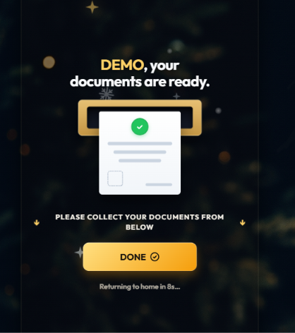
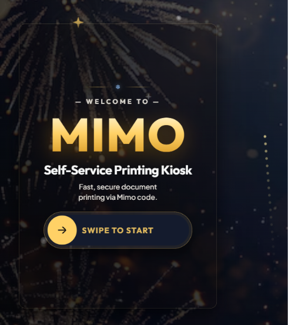

# MIMO Self-Service Printing Kiosk UI

> **Note:** This `README.md` is standalone repository documentation and has no functional effect on the web application.

Touch-screen self-service document release kiosk interface for **MIMO**, designed and scaled for **15-inch diagonal tablets** in both landscape and portrait orientations. Built with React 19, Vite, Motion (`motion/react`), and custom CSS glassmorphism.

---

## Setup Instructions

### Prerequisites

- **Node.js** `>= 18` (LTS recommended) and **npm** (or **Bun**)

### 1. Install Dependencies

```bash
npm install
```

### 2. Environment Variables (Optional)

The interactive kiosk UI runs entirely client-side using a mock print-job API (`src/api/mock.js`). An `.env.example` template is included in the repository root if you later connect environment-based services (`GEMINI_API_KEY`, `APP_URL`), though no environment variables are required to run the kiosk locally:

```bash
cp .env.example .env
```

### 3. Run the Development Server

```bash
npm run dev
```

Vite serves the app on **port 3000** (`0.0.0.0:3000`). Open `http://localhost:3000` in your browser or tablet kiosk shell.

### 4. Type-Check, Build & Preview for Production

```bash
# TypeScript check (tsc --noEmit)
npm run lint

# Build production bundle into dist/
npm run build

# Preview the production build locally
npm run preview

# Remove build artifacts (dist/ and server.js)
npm run clean
```

---

## Testing & Kiosk Navigation Flow

All kiosk workflows can be tested directly in the UI without backend hardware:

| Action / 4-Digit Code | Resulting Page / Behavior |
| --- | --- |
| Drag **SWIPE TO START** | Smooth directional transition to **Code Entry** (`CODE_ENTRY`) |
| `1234` (or `2027`, `1111`, `2222`, or any valid 4-digit code) | Verifies job (`Demo`, `Guest`, `Alex`, `Maya`) → **Printing** (`PRINTING`, 3 pages over ~9s) → **Summary** (`SUMMARY`) |
| `0000` | Displays invalid-code shake feedback and transitions to **System Error** (`ERR-0000`) |
| `9999` | Opens **Maintenance & Diagnostics** (`MAINTENANCE`, starting on **Out of Paper**) |
| Hold **Backspace** key (`500ms`) | Clears all 4 code slots |
| Idle `60s` on **Code Entry** or `10s` on **Summary** | Automatically resets and returns to **Home** |

---

## Screenshots of Each Page

The application consists of **6 screens** rendered inside an orientation-aware, aspect-scaled kiosk stage (`src/App.jsx`) with GPU-crossfaded backgrounds (`01-image_25e0936d.png` on Home; `Gemini_Generated_Image_vcqip6vcqip6vcqi_47b4d61f.png` on all subsequent screens) and `540ms` directional `AnimatePresence` transitions.

> Snapshot images below come from `public/assets/aistudio/` captured during UI development.

### 1. Home Screen (`src/screens/HomeScreen.jsx`)


- **Background:** Festive *Happy New Year* gold bokeh backdrop (`/assets/aistudio/01-image_25e0936d.png`) layered with subtle fireworks and sparse snowfall.
- **UI Elements:** Sheer centered card (`WELCOME TO MIMO`, `Self-Service Printing Kiosk`, `Fast, secure document printing via Mimo code.`) and an interactive spring-physics **SWIPE TO START** slider (`SlideCommit`).

---

### 2. Code Entry Screen (`src/screens/CodeEntryScreen.jsx`)



- **Background:** Golden ornamented Christmas tree backdrop (`/assets/aistudio/Gemini_Generated_Image_vcqip6vcqip6vcqi_47b4d61f.png`) with top-left `MIMO` branding and solid **Back** button (`GlobalHeader`).
- **UI Elements:** Single-column vertical layout with **"Enter Your Mimo Code Here"** and 4 animated `CodeSlots` stacked above a touch-sized `3×4` numeric keypad (`1–9`, hold-to-clear backspace, `0`, and gold checkmark confirm button).

---

### 3. Printing Progress Screen (`src/screens/PrintingScreen.jsx`)


- **Background:** Ornamented Christmas tree backdrop (`Gemini_Generated_Image_vcqip6vcqip6vcqi_47b4d61f.png`) with sparse ambient snowfall.
- **UI Elements:** Personalized greeting card (`Hello Demo..!`, `Printing in progress…`, `Please wait.`) paired with a large circular `CometDial` progress gauge showing percentage completion (`0%` → `100%`), lifecycle status (`Warming up printer…`, `Preparing pages…`, `Printing documents…`, `Finishing up…`), page counter (`Page X of 3`), and a bottom paper safety notice.

---

### 4. Summary / Documents Ready Screen (`src/screens/SummaryScreen.jsx`)



- **Background:** Ornamented Christmas tree backdrop paired with celebratory canvas fireworks (`FireworksCanvas` in `celebrate` mode) and a confetti burst (`FestiveCelebrationBurst`).
- **UI Elements:** `"DEMO, your documents are ready."` headline, animated document dispenser slot graphic, `"PLEASE COLLECT YOUR DOCUMENTS FROM BELOW"` instruction, prominent gold **DONE** button, and a 10-second auto-reset countdown (`Returning to home in Xs…`).

---

### 5. System Error Screen (`src/screens/SystemErrorScreen.jsx`)

- **How to View / Capture:** Swipe to start and enter code **`0000`** on the Code Entry keypad. *(No pre-captured PNG is included in `public/assets/aistudio/` for this screen yet.)*
- **UI Elements:** Displays the `SYSTEM ERROR · ERR-0000` badge, **"Printing Failed"** heading, structured diagnostic rows (`Release Code`, `Print Status: Job Aborted — No Pages Printed`, `Recommended Action`), **RETRY** and **BACK TO HOME** action buttons, and a kiosk support reference footer.

---

### 6. Maintenance & Diagnostics Screen (`src/screens/MaintenanceScreen.jsx`)

- **How to View / Capture:** Swipe to start and enter code **`9999`** on the Code Entry keypad. *(No pre-captured PNG is included in `public/assets/aistudio/` for this screen yet.)*
- **UI Elements:** Switchable diagnostic tabs (**Machine Offline**, **Out of Paper**, **Other Notices**), live station telemetry grid (`Print Server`, `Paper Trays`, `Toner Levels`, `Service Door` / `Thermal Fuser`), active maintenance notifications feed, **REFRESH STATUS** diagnostics check button, and **BACK TO HOME**.

---

## Project Structure

```text
.
├── public/assets/aistudio/   # Background artwork and historical reference screenshots
├── src/
│   ├── api/mock.js           # Mock print-job verification & metadata lookup
│   ├── components/           # GlobalHeader, SlideCommit, CodeSlots, CometDial, FireworksCanvas, FestiveDecorations
│   ├── hooks/                # useIdleTimeout
│   ├── screens/              # HomeScreen, CodeEntryScreen, PrintingScreen, SummaryScreen, SystemErrorScreen, MaintenanceScreen
│   ├── styles/theme.css      # Design tokens, kiosk typography, glassmorphism, & background layers
│   ├── App.jsx               # Stage scaling, route orchestration, & AnimatePresence transitions
│   └── main.jsx              # Application entry point
├── index.html                # HTML shell
├── package.json              # Scripts and dependencies
└── vite.config.ts            # Vite + React + Tailwind configuration
```
