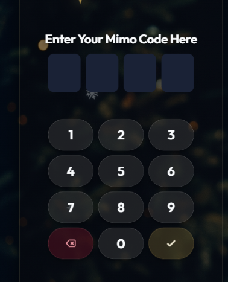
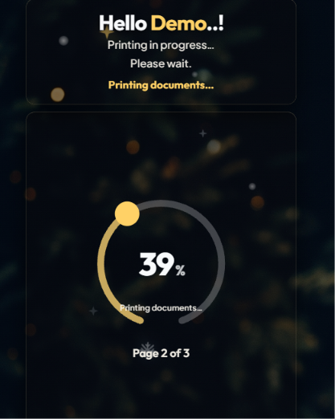

# MIMO Self-Service Printing Kiosk UI

> **Note:** This `README.md` is standalone repository documentation and has no functional effect on the web application.

Light-mode touch-screen self-service document release kiosk interface for **MIMO**, dynamically scaled for **15-inch diagonal tablets** in both landscape (`1260–1820 × 1000`) and portrait (`1080 × 1620–1920`) orientations. Built with React 19, Vite, Motion (`motion/react`), and frosted daylight glassmorphism.

---

## Present UI & Visual State

- **Theme:** Light Mode (`color-scheme: light`, `#f4f6fa` base, `#0f172a` primary ink, `#334155` secondary text, `#f59e0b` / `#d97706` amber accents, and frosted daylight glass cards).
- **Minimal Header (`src/components/GlobalHeader.jsx`):** Both the printer emblem icon and the top-left `MIMO / SELF-SERVICE PRINTING KIOSK` header branding have been removed across all screens. Only the circular gold **Back** button renders in the top-left corner on the **Code Entry** screen.
- **Page Backgrounds (`src/App.jsx`):**
  - **Page 1 (`HOME`):** `./public/assets/aistudio/Bg1_330e24eb.png` (`object-position: right center`), paired with subtle `FireworksCanvas` (`ambient`) and `FestiveSnowfall`.
  - **Pages 2–6 (`CODE_ENTRY`, `PRINTING`, `SUMMARY`, `ERROR`, `MAINTENANCE`):** `./public/assets/aistudio/Bg2_d42c6f07.png` (`object-position: center center`).

---

## Setup Instructions

### Prerequisites

- **Node.js** `>= 18` (LTS recommended) and **npm**

### 1. Install Dependencies

```bash
npm install
```

### 2. Environment Variables (Optional)

The interactive kiosk UI runs entirely client-side using a mock print-job API (`src/api/mock.js`). An `.env.example` template is included in the repository root if you later connect backend services (`GEMINI_API_KEY`, `APP_URL`), though no environment variables are required to run the kiosk locally:

```bash
cp .env.example .env
```

### 3. Run the Development Server

```bash
npm run dev
```

Vite serves the app on **port 3000** (`0.0.0.0:3000`). Open `http://localhost:3000` in your browser or tablet kiosk shell.

### 4. Type-Check, Build & Preview for Production

```bash
# TypeScript check (tsc --noEmit)
npm run lint

# Build production bundle into dist/
npm run build

# Preview the production build locally
npm run preview

# Remove build artifacts (dist/ and server.js)
npm run clean
```

---

## Testing & Kiosk Navigation Flow

All kiosk workflows can be tested directly in the UI without printer hardware (`src/api/mock.js` + `src/App.jsx`):

| Action / 4-Digit Code | Resulting Page / Behavior |
| --- | --- |
| Drag **SWIPE TO START** | Smooth directional transition to **Code Entry** (`CODE_ENTRY`) |
| `1234` (`Demo`), `2027` (`Guest`), `1111` (`Alex`), `2222` (`Maya`), or any other 4-digit code except `0000` / `9999` | Verifies job (`800ms`) → **Printing** (`PRINTING`, 3 pages over `9s` + `1s` hold at `100%`) → **Summary** (`SUMMARY`) |
| `0000` | Displays invalid-code shake feedback and transitions to **System Error** (`ERR-0000`) |
| `9999` | Opens **Maintenance & Diagnostics** (`MAINTENANCE`, starting on **Out of Paper**) |
| Hold **Backspace** key (`500ms`) | Clears all 4 code slots |
| Idle `60s` on **Code Entry** or `10s` countdown on **Summary** | Automatically resets and returns to **Home** |

---

## Pages & Visual Overview

The application consists of **6 screens** rendered inside an orientation-aware, aspect-scaled kiosk stage (`src/App.jsx`) with GPU-crossfaded backgrounds and `360ms` directional `AnimatePresence` transitions.

### Active Background Assets

| First Page (`HOME`) Background (`Bg1`) | Pages 2–6 Background (`Bg2`) |
| :---: | :---: |
|  |  |

---

### 1. Home Screen (`src/screens/HomeScreen.jsx`)

- **Current State (Light Mode):** Displays the cream-and-gold *Happy New Year* filigree & bokeh backdrop (`Bg1_330e24eb.png`) with subtle ambient fireworks and snowfall. Features a highly translucent frosted hero card (`rgba(255, 255, 255, 0.16)`, `6px` blur) so the background artwork remains clearly visible behind **`— WELCOME TO —`**, the gold gradient **`MIMO`** display title, **`Self-Service Printing Kiosk`**, and the interactive spring-physics **`SWIPE TO START`** slider (`SlideCommit`). No top-left header logo or branding is shown.
- *Earlier Dark-Mode Layout Reference (`public/assets/aistudio/`):*

  

---

### 2. Code Entry Screen (`src/screens/CodeEntryScreen.jsx`)

- **Current State (Light Mode):** Uses the `Bg2_d42c6f07.png` backdrop with a bright frosted glass card, no top-left `MIMO` header text, and a circular gold **Back** button in the top-left header. Shows **"Enter Your Mimo Code Here"**, 4 animated light-mode `CodeSlots`, and a touch-sized `3×4` numeric keypad (`1–9`, red hold-to-clear backspace button, `0`, and gold/amber checkmark confirm button).
- *Earlier Dark-Mode Layout Reference (`public/assets/aistudio/`):*

  

---

### 3. Printing Progress Screen (`src/screens/PrintingScreen.jsx`)

- **Current State (Light Mode):** Uses `Bg2_d42c6f07.png` with frosted daylight cards, no top-left header branding, personalized greeting card (`Hello Demo..!` / `Guest` / `Alex` / `Maya`, `Printing in progress…`, `Please wait.`), and a large read-only `CometDial` (`#0f172a` ink track + `#f59e0b` amber comet progress arc). Both the percentage figure (`0%` → `100%`) and the stage label (`Warming up printer…`, `Preparing pages…`, `Printing documents…`, `Finishing up…`) are centered together inside the clear inner circle so the text never overlaps the progress ring or comet head, above `Page X of 3` and the bottom paper notice.
- *Earlier Dark-Mode Layout Reference (`public/assets/aistudio/`):*

  

---

### 4. Summary / Documents Ready Screen (`src/screens/SummaryScreen.jsx`)

- **Current State (Light Mode):** Uses `Bg2_d42c6f07.png` layered with celebratory canvas fireworks (`FireworksCanvas` in `celebrate` mode) and a confetti burst (`FestiveCelebrationBurst`), without top-left header branding. Displays **`"<NAME>, your documents are ready."`**, the animated document dispenser slot graphic, **`PLEASE COLLECT YOUR DOCUMENTS FROM BELOW`**, the gold **`DONE`** button, and a 10-second auto-reset countdown (`Returning to home in Xs…`).
- *Earlier Dark-Mode Layout Reference (`public/assets/aistudio/`):*

  

---

### 5. System Error Screen (`src/screens/SystemErrorScreen.jsx`)

- **How to View:** Swipe to start and enter code **`0000`** on the Code Entry keypad. *(No screenshot PNG exists in `public/assets/aistudio/` for this screen yet.)*
- **Current State (Light Mode):** Uses `Bg2_d42c6f07.png` with a daylight frosted card (no header branding), displaying the `SYSTEM ERROR · ERR-0000` badge, **"Printing Failed"** heading, structured diagnostic rows (`Release Code`, `Print Status: Job Aborted — No Pages Printed`, `Recommended Action`), **RETRY** and **BACK TO HOME** buttons, and a kiosk support reference footer.

---

### 6. Maintenance & Diagnostics Screen (`src/screens/MaintenanceScreen.jsx`)

- **How to View:** Swipe to start and enter code **`9999`** on the Code Entry keypad. *(No screenshot PNG exists in `public/assets/aistudio/` for this screen yet.)*
- **Current State (Light Mode):** Uses `Bg2_d42c6f07.png` with a daylight frosted card (no header branding), switchable diagnostic tabs (**Machine Offline**, **Out of Paper**, **Other Notices**), live station telemetry grid (`Print Server`, `Paper Trays`, `Toner Levels`, `Service Door` / `Thermal Fuser`), active maintenance notifications list, **REFRESH STATUS** diagnostics check button, and **BACK TO HOME**.

---

## Project Structure

```text
.
├── public/assets/aistudio/   # Active backgrounds (Bg1_330e24eb.png, Bg2_d42c6f07.png) & historical PNGs
├── src/
│   ├── api/mock.js           # Mock print-job verification & metadata lookup (Demo, Guest, Alex, Maya)
│   ├── components/           # GlobalHeader, SlideCommit, CodeSlots, CometDial, FireworksCanvas, FestiveDecorations
│   ├── hooks/                # useIdleTimeout
│   ├── screens/              # HomeScreen, CodeEntryScreen, PrintingScreen, SummaryScreen, SystemErrorScreen, MaintenanceScreen
│   ├── styles/theme.css      # Light-mode design tokens, typography, daylight glassmorphism, & background layers
│   ├── App.jsx               # Stage scaling, route orchestration, background crossfade, & AnimatePresence transitions
│   └── main.jsx              # Application entry point
├── index.html                # HTML shell (light color-scheme)
├── package.json              # Scripts and dependencies
└── vite.config.ts            # Vite + React + Tailwind configuration
```
